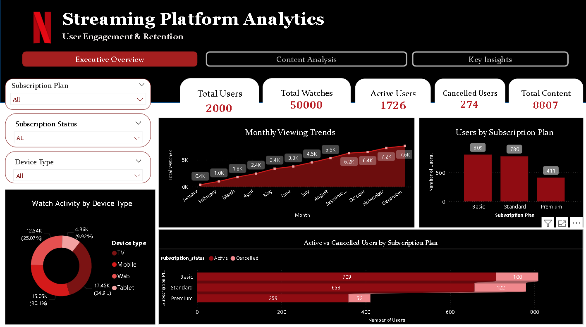
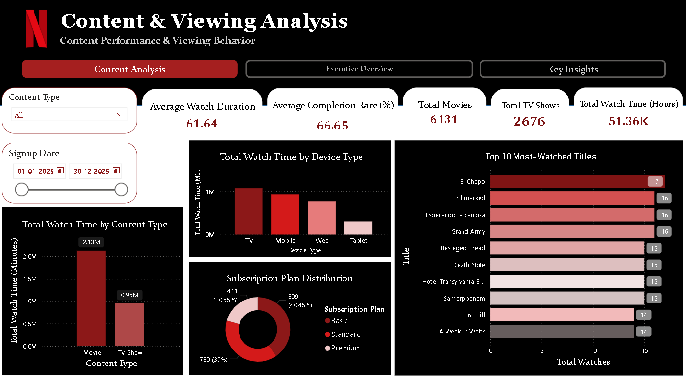
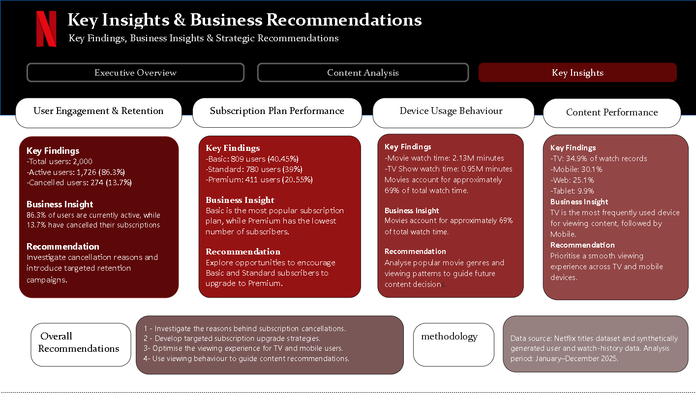
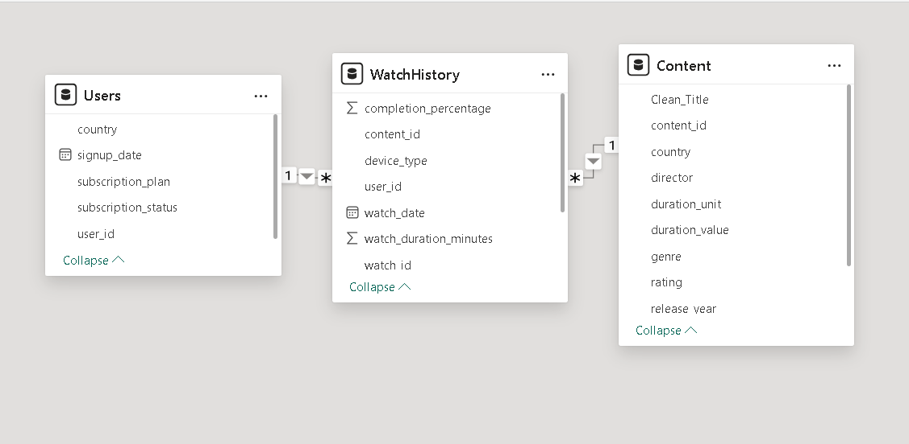
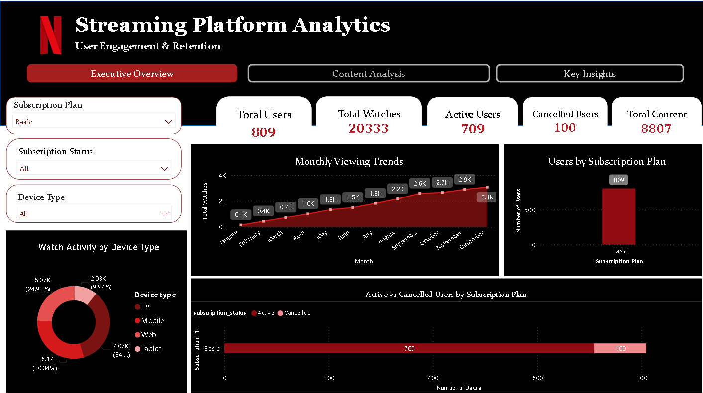

# Streaming Platform User Engagement & Retention Analysis

## Project Overview

This project analyses user engagement, subscription behaviour, content performance, and viewing patterns for a fictional streaming platform inspired by Netflix.

The objective is to understand how users interact with the platform, identify subscription cancellation patterns, analyse content consumption, and generate actionable business recommendations.

## Business Objectives

- Analyse user engagement and subscription activity.
- Understand subscription plan distribution.
- Identify cancelled users and examine retention patterns.
- Analyse viewing behaviour across different devices.
- Identify the most-watched titles.
- Compare movie and TV show viewing performance.
- Develop business insights and recommendations.

## Tools & Technologies

- **Python:** Pandas, NumPy
- **SQL:** SQL Server, Joins, Aggregations, Subqueries, CTEs
- **Power BI:** Interactive dashboards, data modelling, DAX
- **Jupyter Notebook:** Data cleaning and preparation
- **Excel/CSV:** Dataset storage and management

## Dataset Description

The project uses the Netflix titles dataset and synthetically generated user and watch-history data.

| Dataset | Records | Description |
|---|---:|---|
| Content | 8,807 | Movies and TV shows |
| Users | 2,000 | User and subscription information |
| Watch History | 50,000 | User viewing activity |

**Analysis period:** January–December 2025.

**Important:** User and watch-history datasets are synthetic and created for analytical purposes. The findings do not represent actual Netflix business performance.

## Project Workflow

### 1. Data Cleaning & Preparation — Python

- Cleaned and transformed the Netflix titles dataset.
- Prepared a synthetic user dataset.
- Generated synthetic watch-history records.
- Validated dates and relationships between datasets.
- Prepared CSV files for SQL Server import.

### 2. SQL Analysis

Created SQL tables and relationships between Users, Content, and WatchHistory.

Performed analysis including:

- Subscription plan distribution.
- Subscription cancellation analysis.
- Device usage analysis.
- Top-watched content.
- Monthly viewing trends.
- Watch duration and completion analysis.
- User engagement analysis.

### 3. Power BI Dashboard

Developed a three-page interactive dashboard.

**Page 1: Executive Overview**
- Total users and watches.
- Active and cancelled users.
- Subscription plan distribution.
- Monthly viewing trends.
- Device usage.
- Active vs cancelled users by subscription plan.

**Page 2: Content & Viewing Analysis**
- Average watch duration.
- Average completion rate.
- Total movies and TV shows.
- Total watch time.
- Top 10 most-watched titles.
- Watch time by content type and device type.

**Page 3: Key Insights & Business Recommendations**
- User engagement and retention.
- Subscription plan performance.
- Device usage behaviour.
- Content performance.
- Business recommendations.

## Key Findings

- Total users: 2,000.
- Active users: 1,726 (86.3%).
- Cancelled users: 274 (13.7%).
- Basic plan is the most popular, with 809 subscribers.
- TV accounts for approximately 34.9% of watch records.
- Movies contribute approximately 69% of total watch time.
- Average watch duration: 61.64 minutes.
- Average completion rate: 66.65%.

## Business Recommendations

- Investigate subscription cancellation reasons and improve retention strategies.
- Explore opportunities to encourage subscription upgrades.
- Prioritise viewing experience across TV and mobile devices.
- Analyse popular movie genres and viewing patterns to guide content decisions.

## Project Structure

```text
Streaming_Platform_User_Engagement_Retention/
│
├── 01_Project_Notes/
├── 02_Data/
│   ├── Raw/
│   └── Cleaned/
├── 03_Python/
├── 04_SQL/
├── 05_PowerBI/
├── 06_Screenshots/
├── 07_GitHub/
└── README.md
```

## Dashboard Screenshots

### 1. Executive Overview



### 2. Content & Viewing Analysis



### 3. Key Insights & Business Recommendations



### 4. Data Model



### 5. Interactive Filtering



## Conclusion

This project demonstrates an end-to-end data analytics workflow, from data cleaning and preparation using Python to SQL analysis and interactive dashboard development in Power BI.

It showcases practical skills in data analysis, data modelling, business intelligence, and communicating data-driven insights.
